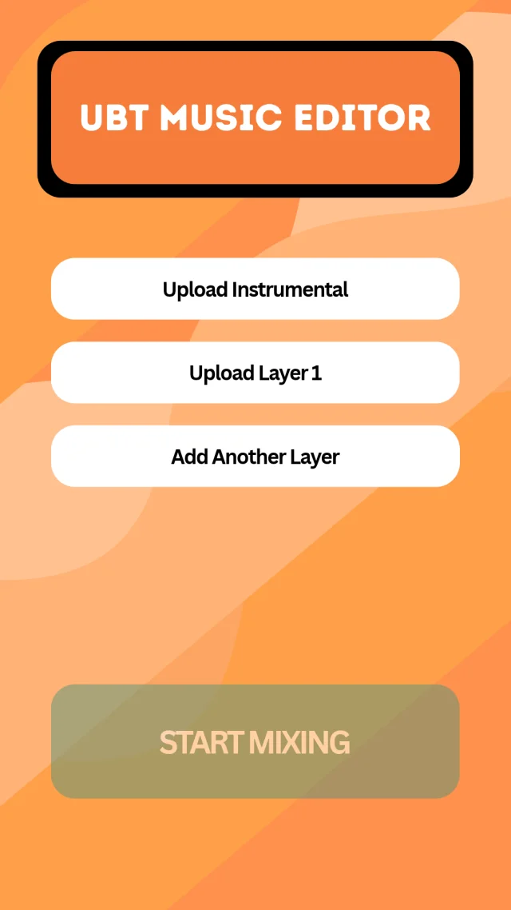

# UBT Music Editor

**From vocal takes to a mix, right in your browser.**

**Status:** Live · [Access-controlled preview](https://ubtmusiceditor.pages.dev) · [View Dylan's portfolio](https://dylanfox.work)

<table><tr><td></td><td><strong>UBT Music Editor</strong></td></tr></table>

*Original interface design. The live editor also includes a cappella mode and adjustable tuning.*

## The product

UBT Music Editor brings vocal layers and an instrumental together in a focused browser studio. It also supports a cappella sessions without an instrumental. Add your recordings, choose a tuning strength, then preview the mix, adjust the session, and export a 24-bit stereo WAV.

## What I built

- Instrumental and multiple vocal layers, with a vocals-only / a cappella mode
- Light-to-heavy tuning control, plus individual layer levels and timing offsets
- On-device melody analysis and audio processing for tuning, cleanup, EQ, dynamics, effects, and mix balance
- Mix progress, playback preview, revision, and a downloadable processing report
- 24-bit PCM stereo WAV export

Product design and implementation by Dylan Fox.

## Using the preview

The live studio requires access. Recordings are processed on your device and are not uploaded for mixing. Closing the tab or starting a new session discards the session; download any mix you want to keep. Supported input formats and practical session size depend on your browser and device. Results depend on the source recordings, so review the preview before export.

## Repository note

This is a public product showcase containing documentation, branding, and an interface design reference. The application source code and deployment configuration remain private.

© 2026 Dylan Fox. All rights reserved.
